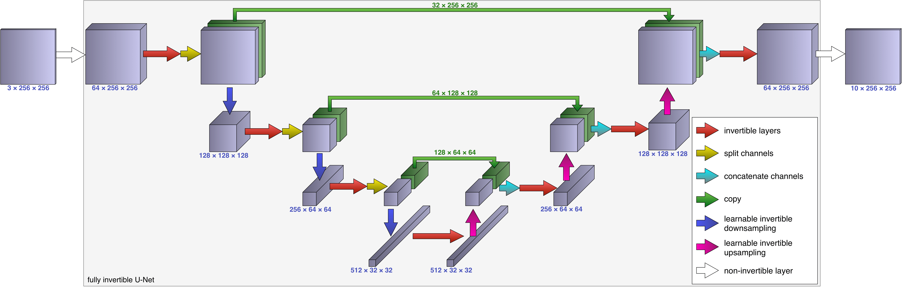

===========================================
iUNets - Fully invertible U-Nets in PyTorch
===========================================

This library enables highly memory-efficient training of **fully invertible
U-Nets (iUNets)** in 1D, 2D, and 3D for use cases such as segmentation of medical
images. The project is based on `iUNets: Fully
invertible U-Nets with Learnable Up- and Downsampling
<https://arxiv.org/abs/2005.05220>`_ by Christian Etmann, Rihuan Ke &
Carola-Bibiane Schönlieb.

Install with ``pip install iunets`` (Python 3.10 or newer, PyTorch 2.3 or
newer). The runtime depends on PyTorch alone.

Official documentation:
`https://iunets.readthedocs.io <https://iunets.readthedocs.io>`_.

By combining reversible layers (such as additive coupling layers) with
**learnable invertible up- and downsampling operators** and suitable channel
splitting and concatenation, the iUNet is fully bijective. This allows for
*reconstructing* internal activations *instead of storing* them, reducing
activation storage as block depth grows.

   An iUNet used as a memory-efficient sub-network for segmenting a 3-channel
   input into 10 classes.

Features
--------

- Memory-efficient iUNets in 1D, 2D, and 3D that integrate with the PyTorch workflow.
- Customizable reversible modules.
- Learnable, invertible, and possibly anisotropic up- and downsampling.
- Orthogonal channel mixing.
- Native inverse-based gradient reconstruction.
- Automatic padding and unpadding, as well as model layout summaries.

Example usage
-------------

.. code-block:: python

   import torch
   from iunets import IUNet

   torch.manual_seed(0)
   model = IUNet(channels=(4, 8), architecture=(1, 1), dim=2)
   optimizer = torch.optim.Adam(model.parameters(), lr=1e-3)
   x = torch.randn(2, 4, 16, 16)
   target = torch.flip(x, dims=(-1,))

   optimizer.zero_grad()
   loss = torch.nn.functional.mse_loss(model(x), target)
   loss.backward()
   optimizer.step()
   print(f"loss: {loss.item():.3f}")
   print(model.layout())

The default
``gradient_mode="reconstruct"`` stores encoder and decoder boundaries, then
reconstructs internal activations during backward. This reduces activation
storage as block depth grows, at the cost of extra computation. Use
``gradient_mode="autograd"`` for custom modules with stochastic behavior or
mutable state. See the `documentation <https://iunets.readthedocs.io/>`_ for
custom module requirements, padding, and transforms.

Development with uv
-------------------

.. code-block:: console

   uv sync --frozen --extra docs
   uv run pytest
   uv run sphinx-build -b html docs docs/_build/html
   uv build

``uv.lock`` pins the contributor environment. Published package requirements
have minimum versions without upper caps.

Citation
--------

If you use iUNets in research, cite:

.. code-block:: bibtex

   @inproceedings{etmann2020iunets,
     title={iUNets: learnable invertible up-and downsampling for large-scale inverse problems},
     author={Etmann, Christian and Ke, Rihuan and Sch{\"o}nlieb, Carola-Bibiane},
     booktitle={2020 IEEE 30th International Workshop on Machine Learning for Signal Processing (MLSP)},
     pages={1--6},
     year={2020},
     organization={IEEE}
   }
